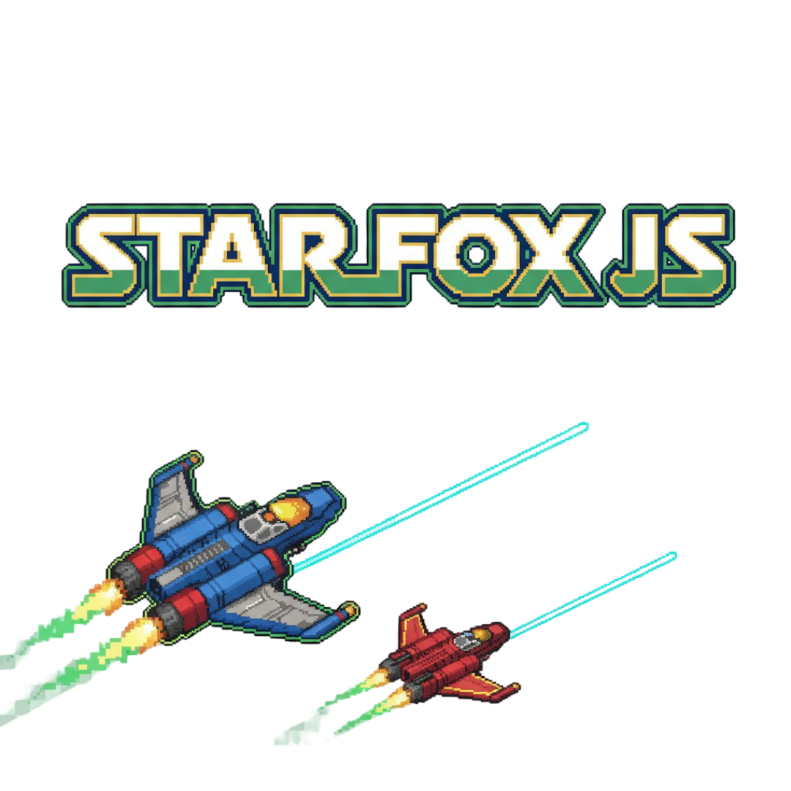

# starfox.js

<p align="center">
  
</p>

<p align="center">
  <a href="https://github.com/trstnjmn/starfox.js">github.com/trstnjmn/starfox.js</a>
</p>

A small browser-based arcade game inspired by Star Fox, built with [PixiJS](https://pixijs.com/).

**In short:** fly the Arwing with mouse or keyboard, fire with the left mouse button or space bar, dodge the enemies, and collect power-ups.

<p align="center">
  <a href="https://starfox-js.vercel.app" target="_blank">Demo</a>
</p>

---

## Features

- PixiJS rendering via CDN (`index.html`), full-window canvas that fills the whole viewport, crisp on high-DPI screens.
- Playable on desktop **and** mobile/touch devices, and on small screens: a responsive UI scale and responsive gameplay asset sizing adapt the layout and sprite sizes to the viewport (the UI scale has a higher minimum on mobile so text stays readable).
- Start screen to pick a control scheme (mouse/touch or keyboard); can also be changed from the pause menu. The choice is stored in `localStorage`. On touch devices the controls default to touch and the keyboard option is hidden.
- 5 difficulty levels (Very Easy … Extreme) selectable with chevron arrows (start and pause menu). The level controls the spawn rate and the maximum number of collectible lives. Default = level 4 (Hard). Stored in `localStorage` (`starfox_difficulty`).
- Mouse **and** keyboard controls on desktop (arrow keys or WASD, space bar to fire); on touch devices, drag anywhere to steer the Arwing and it fires automatically while you hold.
- The Arwing tilts left/right while flying.
- Enemy spawns that get denser as the difficulty rises.
- Enemy behavior: `ship1`/`ship2` fly sideways and shoot, `rock` rotates and varies in size, `satellite` flies in an orbit, `bork` takes two hits and explodes on the second one with a blast radius.
- Hits on `ship1`/`ship2`/`satellite`: they switch to their damage sprite and tumble downwards (briefly without a hitbox, then collidable again).
- Health/lives system (3 lives) with brief invulnerability after a hit; the Arwing shows the matching damage sprites (`Arwing_damage_1/2.png`), `bork` shows `bork_damaged.png` after the first hit.
- Retro pixel-art power-ups (blocky tiles with a symbol): Rapid Fire (R), Spread Shot (S), Shield (D), and a rare 1UP (cross) for an extra life (max. 5).
- `bork` occasionally teleports to a random new position with a pixel-burst effect (briefly invulnerable). After the **first** hit it teleports away immediately (with its damage sprite) and is invulnerable while doing so.
- All gameplay assets (Arwing, enemies, lasers, power-ups, explosions, shield) are scaled via `worldScale` (base `ASSET_SCALE = 1.25`), which shrinks on small screens so everything stays proportionate.
- `logo.png` as the browser-tab favicon and as a subtle background watermark in the main and pause menu.
- Warning sound (`warning.mp3`) loops as long as only one life is left (stops on pause/game over/mute).
- Scoreboards per difficulty level (5 of them), top 5 each with **name (max. 5 characters)**, score, and **date** (`localStorage` under `starfox_scores`).
- Retro name entry on the game-over screen (HTML overlay in 8-bit style); Enter saves, the name is remembered in `starfox_name`.
- Big **START** button in the main menu; selecting controls or difficulty in the menu plays a `ui_confirm.mp3` confirmation sound.
- Pause menu with "Resume", "Restart", and "Main Menu"; game-over screen with "Restart" and "Main Menu".
- Mute/unmute toggle for sound.
- Scrolling starfield and screen shake on explosions.
- Music menu (`Music` button in the main menu): lists every track from `assets/sounds/music/` ("Musik 1"–"Musik 5", "Menü Musik") for listening, plus "Stop". An Arwing spins like a vinyl record in the center while music is playing.
- Sound effects (e.g. `level_up.mp3` on power-up, `game_over.mp3` on game over) in `assets/sounds`.
- Main menu: `assets/sounds/music/menu_music.mp3` loops in the background.
- On game start (`startGame`/`restartGame`) `game_start.mp3` plays first. The in-game music only starts **with the player's first shot**: a random starting track is picked from `assets/sounds/music/` (`music_1.mp3`–`music_5.mp3`); the tracks then play **back to back** and loop afterwards.
- All music transitions use a crossfade (fade-out/fade-in, `MUSIC_FADE_MS = 900` in `app.js`); playlist transitions are blended shortly before a track ends.
- After starting/resuming the game, the first click/shot does not fire immediately — only after releasing the fire button (prevents an accidental start shot from the start/resume button).
- **Installable as an app (PWA):** a web app manifest, icons, and a service worker are included, so the game can be installed to the home screen and starts in fullscreen without browser chrome. See [Install as an app (PWA)](#install-as-an-app-pwa).

---

## Quick Start

- **Simple (local):** double-click `index.html` or open it in your browser.
- **Recommended** (better media/audio behavior): start a simple HTTP server in the project folder and open `http://localhost:8000`:

```bash
python3 -m http.server 8000
# or (Node.js)
npx http-server -c-1 .
```

## Requirements

- A modern web browser with JavaScript enabled.
- No further installation needed (PixiJS is loaded via CDN).

---

## Controls

### Desktop

- **Start:** on the start screen pick a control scheme ("Mouse" or "Keyboard") and a difficulty, then click **START** — the choice is saved. The "Music" button also lets you listen to a track.
- **Mouse:** move the ship (Arwing) through the game world (mouse mode only).
- **Keyboard:** arrow keys or WASD (keyboard mode only).
- **Fire:** left mouse button or space bar.
- **Pause:** `P` or `Escape`. From the pause menu you can change the control scheme, restart, or return to the main menu. The game also auto-pauses when the window loses focus.
- **Restart after game over:** `R`, click "Restart", or "Main Menu".
- **Sound:** `M` or click "Sound: ON/OFF".

### Mobile / touch

- **Start:** tap a difficulty and **START** (the control selector shows "Touch").
- **Steer:** drag anywhere on the play area — the Arwing follows your drag (relative movement, so it never jumps under your finger).
- **Fire:** fires automatically while you hold/touch and drag.
- **Pause / menus:** tap the on-screen buttons; the pause menu offers "Resume", "Restart", and "Main Menu".
- Scrolling, pinch-zoom, and pull-to-refresh are disabled during play.

---

## Install as an app (PWA)

The game is a Progressive Web App and can be installed to the phone/desktop home screen so it launches fullscreen like a native app.

**Requirements:** it must be served over **HTTPS** (or `http://localhost`). Opening `index.html` directly via `file://` will **not** offer installation and the service worker will not register. The easiest way is to host the folder (e.g. GitHub Pages, Vercel, Netlify) — see the demo URL at the top.

- **Android / Chrome / Edge:** open the site, then use the browser menu → **"Install app"** / **"Add to Home screen"**. Chrome may also show an automatic install prompt.
- **iOS / Safari:** open the site, tap the **Share** button, then **"Add to Home Screen"**. (iOS reads the `apple-touch-icon` and the `apple-mobile-web-app-*` meta tags.)
- **Desktop (Chrome/Edge):** an install icon appears in the address bar.

Included PWA files:

| File | Purpose |
| --- | --- |
| `manifest.webmanifest` | App name, colors, `display: standalone`, icons. |
| `service-worker.js` | Caches the app shell (HTML/CSS/JS, PixiJS CDN, icons) for offline use and enables installation. |
| `assets/icons/icon-192.png`, `icon-512.png` | Standard app icons. |
| `assets/icons/icon-maskable-512.png` | Maskable icon for Android adaptive icons. |
| `assets/icons/apple-touch-icon.png` | iOS home-screen icon. |

After changing a cached file, bump `CACHE_NAME` in `service-worker.js` (e.g. `starfoxjs-v2`) so clients pick up the new version.

---

## Project Structure

| File | Purpose |
| --- | --- |
| `index.html` | Simple HTML entry point; viewport/PWA meta tags, manifest link, service-worker registration, and loads `gameloop.js`, the PixiJS CDN, and `app.js`. |
| `app.js` | Main game logic: sprites, spawn logic, input (mouse/keyboard/touch), responsive scaling, lives, score, power-ups, audio control. |
| `gameloop.js` | Timing/helper functions, keyboard input state, and collision helpers. |
| `styles.css` | Fullscreen layout and retro styles (name-entry overlay, etc.). |
| `manifest.webmanifest` | Web app manifest (PWA) with name, colors, and icons. |
| `service-worker.js` | Caches the app shell for offline use and enables installation. |
| `assets/` | Images, sound effects, background music, and PWA icons (see below). |
| `README.md` | This document. |

---

## Assets Guide

All game assets live under `assets/`. Most images are designed on a 1080×1080 base; damage variants use 500×500 and are normalized to the base display size at runtime via `swapTextureFitted()`.

### Images (`assets/`)

| File | Used as |
| --- | --- |
| `arwing.png` | The player ship (Arwing). Also used as the spinning record label in the music menu. |
| `Arwing_damage_1.png` | Player sprite at 2 lives. |
| `Arwing_damage_2.png` | Player sprite at 1 life. |
| `ship1.png` / `ship1_damaged.png` | Enemy `ship1` (normal / damaged-crash sprite). |
| `ship2.png` / `ship2_damaged.png` | Enemy `ship2` (normal / damaged-crash sprite). |
| `rock.png` | Enemy `rock` (rotating asteroid, no damage sprite). |
| `satellite.png` / `satellite_damaged.png` | Enemy `satellite` (normal / damaged-crash sprite). |
| `bork.png` / `bork_damaged.png` | Enemy `bork` (normal / damaged sprite). |
| `laser.png` | Projectile for the player and enemies. |
| `explosion.png` | Explosion sprite used for hits and blast effects. |
| `logo.png` | Favicon (`index.html`) and background watermark in the main/pause menu. |
| `starFoxJs.png` | Small "Star Fox JS" logo shown in the in-game HUD. |

### Sound effects (`assets/sounds/`)

| File | Trigger |
| --- | --- |
| `game_start.mp3` | Plays once when a round starts (`startGame`/`restartGame`). |
| `game_over.mp3` | Plays on game over. |
| `level_up.mp3` | Plays when a power-up is collected. |
| `ui_confirm.mp3` | Menu selection confirmation sound. |
| `warning.mp3` | Loops while only one life is left. |
| `laser1.mp3`, `laser2.mp3` | Player/enemy laser shots; also the `bork` teleport sound. |
| `explosion1.mp3`, `explosion2.mp3`, `explosion3.mp3` | Randomly picked small explosion sounds. |
| `explosionMaster.mp3` | Big explosion (e.g. `bork`'s final blast). |
| `game-over.mp3` | Unused (legacy; the hyphenated variant is not referenced). |
| `menu_music.mp3` | Unused legacy copy at the sounds root — the music folder copy is used. |

### Music (`assets/sounds/music/`)

| File | Role |
| --- | --- |
| `menu_music.mp3` | Loops in the main menu (and is previewable in the music menu). |
| `music_1.mp3` … `music_5.mp3` | In-game playlist. One is picked at random on the first shot, then they play back to back and loop. |

**Adding more in-game tracks:** drop `music_6.mp3` (etc.) into `assets/sounds/music/` and add the filename to the `GAME_MUSIC_FILES` array near the top of `app.js`. The music menu builds its buttons automatically from that list.

---

## Developer Notes

- PixiJS is loaded from the CDN in `index.html` (version 7.x). For offline or bundled builds you can install Pixi locally.
- **Responsive scaling:** `computeScales()` (called from `layoutUI`) derives `uiScale` (menus/HUD/game-over text) and `worldScale` (gameplay sprites). Menu containers are scaled around the screen center via a pivot trick; HUD and game-over elements are scaled individually. `layoutUI` runs on boot and on every window resize.
- **Touch input:** native `touchstart`/`touchmove`/`touchend` listeners on the canvas drive the same target position and fire state as the mouse, using relative dragging. They are guarded to only act on the canvas so the HTML name-entry field can still be focused.
- **Audio playback:** browsers usually block autoplay, so the game starts music/sounds from a user gesture. On first load it tries to play the menu music immediately; if the browser blocks it, it starts (and unmutes) on the first interaction — a hint is shown on the start screen until it succeeds. The in-game music starts on the first player shot as a randomly chosen playlist from `assets/sounds/music/` and is blended with a crossfade (`updateMusicFades` in the Pixi `ticker`).
- The game update runs on the Pixi `ticker` (requestAnimationFrame); key input is mirrored into `gameInput` in `gameloop.js`.
- Collisions use AABB via `getBounds()` and work independently of the scene hierarchy (layers `starLayer`, `gameLayer`, `uiLayer`).
- Persistent state is kept in `localStorage`: `starfox_control`, `starfox_difficulty`, `starfox_scores`, `starfox_highscore`, `starfox_name`.

---

## Contributing

- Pull requests are welcome. Please include a short description and reproduction steps for your changes.
- Repository: <https://github.com/trstnjmn/starfox.js>
- Please add a license file (`LICENSE`) — there is currently no license notice.
